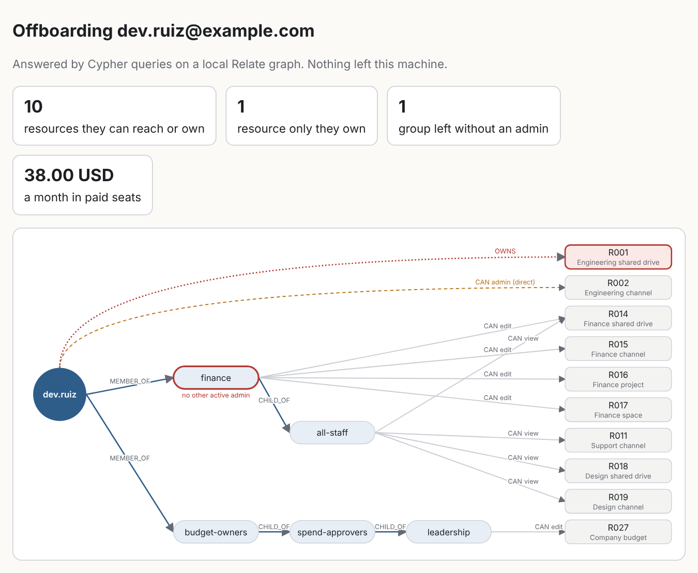

# Offboarding Graph

**What does a leaver still have, and what breaks if you remove it?** For the IT person handling someone's last day: your SaaS exports or your GitHub access config in one Relate graph, answers from the command line, the browser or an AI assistant, and one HTML page to act on.

**On real data:** Kubernetes publishes its GitHub access as code (kubernetes/org). Loaded into Relate in under a second, 28 of the 80 repositories its teams administer have exactly one admin apart from the 10 organisation owners; 26 of them hang on a single bot account, so `whatif` on that account shows 26 repositories left with no admin but the owners. [The run, step by step](#real-data-kubernetes-own-access-config).

**Try it in your browser, nothing to install:** [sweekly-app.github.io/offboarding-graph](https://sweekly-app.github.io/offboarding-graph/) (Relate's WebAssembly build runs the same Cypher in the page, on an invented demo company) · **Demo video (1:57):** [demo/offboarding-graph-demo.mp4](demo/offboarding-graph-demo.mp4) · **On your machine in a minute:** [Setup and run](#setup-and-run)



## Use case
Someone leaves. Their access is spread over a docs suite, chat, an issue tracker, a wiki and a code host, and each tool exports a flat list. The risks are in the connections between those lists:

- a shared drive **only they own**, and who should own it next;
- a group where **they are the only admin**, so no active admin remains once they go;
- a repository whose **only admin** they are, through whichever team;
- **paid seats** still assigned to people who have left;
- everything they can reach **through nested groups**, not just directly.

## Real data: Kubernetes' own access config
The Kubernetes project manages its GitHub organisations with Peribolos: the org's admins and members, and every team with its maintainers, members, child teams and repository permissions, in YAML in the public repository kubernetes/org. `offgraph import-peribolos` reads it as it is. Measured on 18 Nov 2026 at kubernetes/org commit `3bdfaed` (full log: `offgraph single-admins` and `whatif` below):

| | kubernetes | kubernetes-sigs |
|---|---|---|
| People, teams (nested) | 1,345, 278 (42) | 1,217, 411 (13) |
| Graph in Relate | 3,049 nodes, 4,532 relationships | 3,052 nodes, 4,434 relationships |
| Repositories with team permissions | 80 | 206 |
| **Exactly one admin apart from the 10 org owners** | **28** (26 of them one bot account) | **18** |
| Load, then `single-admins` | 0.8 s, 0.8 s | 0.7 s, 2.0 s |
| Relate's answers against the plain-Python check | equal for all 1,345 people | equal for all 1,217 people |

The organisation owners can still administer every repository, so nothing is locked out; the list is who needs a handover first. These counts describe the public configuration at that commit, not the project's security; they are an example of what the tool reports. To repeat it (PyYAML comes with the `test` extra, or install `.[peribolos]`):
```
git clone https://github.com/kubernetes/org k8s-org
git -C k8s-org checkout 3bdfaed
offgraph import-peribolos k8s-org/config/kubernetes -o k8s
offgraph --store k8s.rl load k8s
offgraph --store k8s.rl single-admins
offgraph --store k8s.rl whatif k8s-publishing-bot
```
`single-admins` ends with `28 resources rest on one admin`, and `whatif` lists the 26 repositories (`kubernetes/api`, `kubernetes/apimachinery`, `kubernetes/kubelet` and 23 more) under "resources left with no admin (app admins not counted)". The question, in Cypher (the admins through any chain of teams, then direct grants, then exactly one left):
```
MATCH (r:Resource)
OPTIONAL MATCH (o:Person)-[:HAS_ACCOUNT]->(:Account {admin: true})-[:IN_APP]->(x:App) WHERE x.name = r.app
WITH r, collect(DISTINCT o.email) AS app_admins
OPTIONAL MATCH (m:Person {status: 'active'})-[:MEMBER_OF]->(:Group)-[:CHILD_OF*0..6]->(:Group)-[e:CAN]->(r)
WHERE e.access = 'admin' AND NOT m.email IN app_admins
…
WHERE size(people) = 1
RETURN r.id AS resource, r.title AS title, people[0] AS admin
```
Nothing about Kubernetes is copied into this repository; the run reads your own clone. People in it are GitHub logins, so the other answers (`reach`, `sole-admin`, `whatif`) take a login where the demo takes an email.

## Three questions a flat export cannot answer
On the invented demo company (60 people, five tools), from the committed store (`offgraph --store demo/offboarding.rl …`).

**1. What can Dev still edit, through groups inside groups?** The Docs sharing list says "leadership"; the directory says Dev is in "budget-owners". Only the chain joins them.
```
MATCH (p:Person {email: $email})-[:MEMBER_OF]->(g0:Group)
MATCH path = (g0)-[:CHILD_OF*0..6]->(g:Group)
MATCH (g)-[:CAN]->(r:Resource)
RETURN DISTINCT r.id AS resource, g.name AS via, [n IN nodes(path) | n.name] AS chain
```
`offgraph reach dev.ruiz@example.com` →
`resource=R027  title=Company budget  app=Docs  access=edit  via=leadership  path=budget-owners > spend-approvers > leadership`

**2. Who should own the drive only Dev owns?** Dev is in Finance; the drive is Engineering's. The suggestion follows the edit grants, not the org chart (ownership × grants × admin roles × status; the full query, with two fallbacks, is `orphans` in `offgraph/graph.py`).
`offgraph orphans dev.ruiz@example.com` →
`resource=R001  title=Engineering shared drive  app=Docs  suggested_owner=ben.weber@example.com  reason=admin of a group that can edit it`

**3. Which groups are left with no other active admin?**
```
MATCH (p:Person {email: $email})-[:MEMBER_OF {role: 'admin'}]->(g:Group)
OPTIONAL MATCH (o:Person {status: 'active'})-[:MEMBER_OF {role: 'admin'}]->(g)
WHERE o.email <> p.email
WITH g, count(o) AS other_admins WHERE other_admins = 0
RETURN g.name AS group_name
```
`offgraph sole-admin dev.ruiz@example.com` → `group_name=finance`

**And before anyone leaves: what breaks if they do?** `whatif` sets their status to left inside a Relate transaction on a temporary copy of the store, asks the questions again, and rolls back; the store itself is never written.
```
offgraph --store demo/offboarding.rl whatif tia.novak@example.com
```
```
If tia.novak@example.com is removed (simulated in a Relate transaction on a copy of the store, then rolled back):
  resources left with no active owner: R027 (Company budget)
  groups left with no active admin: budget-owners, leadership, spend-approvers
  resources nobody active can edit any more: none
  resources left with no admin (app admins not counted): none
  paid seats to remove: 5, 43.00 USD a month
```
The demo company's seat check: `offgraph --store demo/offboarding.rl seats` finds 19 paid seats, 180.00 USD a month, still held by 5 people who left.

## How it uses Relate
- **Mode: single file** (`.rl`), through the Python library (`relate-db` 1.0.1, the engine in-process), and **in the browser** through `@relate/relate-wasm` 1.0.1.
- **Why this mode:** offboarding data is a snapshot an IT person rebuilds from fresh exports, keeps next to the ticket and may hand to an auditor. One file does that: copy it, attach it, open it read-only for reports while nothing else can write to it. No server to run, and nothing leaves the machine.
- **What the graph models:** `(:Person {email, name, team, status})`, `(:Group {name})`, `(:App {name, price})`, `(:Account {key, paid, admin, last_active})`, `(:Resource {id, app, kind, title})`, joined by `MEMBER_OF {role}`, `CHILD_OF`, `CAN {access}`, `OWNS`, `HAS_ACCOUNT`, `IN_APP`. Graph tools for security teams, BloodHound for example, map attack paths through directory groups; this one asks the IT question on someone's last day instead.

| Relate capability | Where it is used |
|---|---|
| Single-file persistent store | `demo/offboarding.rl` is committed and answers straight after install; `offgraph load` writes one `.rl` per snapshot |
| Parameterised `UNWIND` batch load in one transaction | `graph.load_statements`: ten statements, the same in the CLI and the browser page |
| Variable-length paths and `nodes(path)` | `reach` and `paths`: `MEMBER_OF` then `CHILD_OF*0..6` to `CAN`, with the chain of groups returned |
| `OPTIONAL MATCH`, `collect`, `UNWIND`, `CASE`, `coalesce` | the owner suggestion (`orphans`), `single_admins`, `no_admin` |
| Transactions with rollback | `whatif`: status set to left, questions asked again, rolled back on a copy of the store |
| Read-only opens | every question and `offgraph cypher`; a write is refused ("cypher is read-only") |
| WebAssembly build (in-memory) | `docs/index.html` and `offgraph web`: the same rows and Cypher in the page |

**Checked:** `offgraph/oracle.py` computes every answer again in plain Python from the CSV rows, and the engine tests compare the two for all 60 demo people, on a fresh load and on the committed store; `tests/web/check.cjs` does the same for the browser page; and on the Kubernetes run above, Relate and the plain-Python check agree for every person and repository.

## Setup and run
Prerequisites: Python 3.10 or later on Linux, macOS or Windows, and git. Clone this repository and open a terminal in its folder (Windows: see [docs/reference.md](docs/reference.md#windows)).
```
python3 -m venv .venv
. .venv/bin/activate
python -m pip install -U pip
python -m pip install -e ".[test]"
```
The install brings in relate-db 1.0.1, pytest and PyYAML. The first result from the committed store, and its one-page HTML report (it writes `report-dev.ruiz.html`; open it in a browser):
```
offgraph --store demo/offboarding.rl seats
offgraph --store demo/offboarding.rl report dev.ruiz@example.com
```
Rebuild from scratch: `offgraph demo exports` writes the seeded 60-person company (the same files as `demo/exports/`), `offgraph load exports` loads it into `./offgraph.rl`, then ask `offgraph seats`, `offgraph orphans dev.ruiz@example.com`, `offgraph single-admins`, `offgraph checklist dev.ruiz@example.com` or `offgraph audit -o audit.html`. `examples.cypher` has five queries to paste into `offgraph cypher "…"`.

**Your own data:** six CSV files in one folder (people, groups, memberships, accounts, resources, grants; prices optional), or let an importer write them: `offgraph import-peribolos` for a Peribolos config, `offgraph import-github` for JSON saved from GitHub's documented REST endpoints (`gh api --paginate`). The columns, the importers' mappings and everything `offgraph load` refuses are in [docs/reference.md](docs/reference.md). Both importers only read files you saved and write CSV files; nothing is fetched or sent.

**Ask an AI assistant:** `offgraph mcp` is a Model Context Protocol server on stdin/stdout with seven read-only tools (`offboarding_checklist`, `who_takes_over`, `access_paths`, `sole_admin_groups`, `leaver_seats`, `single_admin_resources`, `what_if_removed`), answered by the same Cypher queries. It takes no Cypher from the assistant and opens the store read-only (`what_if_removed` works on a temporary copy). In an MCP client that starts local commands, add a server whose command is the `offgraph` inside `.venv` with the arguments `--store`, the full path to a `.rl` file, and `mcp`; then ask, for example, "what breaks if dev.ruiz@example.com leaves?" Without an assistant, `python examples/mcp_client.py dev.ruiz@example.com offgraph --store demo/offboarding.rl mcp` lists the tools and calls the checklist tool.

## In the browser
`docs/index.html` (published at [sweekly-app.github.io/offboarding-graph](https://sweekly-app.github.io/offboarding-graph/)) imports `@relate/relate-wasm` 1.0.1 from the jsDelivr CDN with Subresource Integrity, creates an in-memory graph, loads the demo company's rows with the same `UNWIND` statements as `offgraph load`, and runs the same Cypher as the command line (each answer shows its query). Each person's access graph is drawn the way `offgraph report` draws it. "What breaks if they leave" sets the person's status to left in the page's graph, asks again, then rebuilds it. It works from GitHub Pages or opened as a local file. `offgraph web <folder> -o page.html` makes the same page for your own exports; the data stays inside that file. `tests/web/check.cjs` opens the page in headless Chromium (over http and from a file) and compares its answers and graph labels with the command line's for all 60 demo people; the last run found no difference.

## Where the data lives
- `demo/offboarding.rl`: the persistent Relate store of the demo company (single file), ready to query; `demo/exports/`: the six CSV files it was built from.
- `demo/offboarding-graph-demo.mp4`: the 1:57 demo recording with captions. Narration: AI-generated voice (ElevenLabs).
- `docs/index.html`: the browser page for the demo company; `docs/reference.md`: commands, CSV columns, importers.
- `examples/peribolos/` and `examples/github/`: made-up organisations in Peribolos' format and in the shape of GitHub's REST API responses; any match with a real account is coincidental. `examples/mcp_client.py`: a minimal MCP client.
- The demo data is invented: every name starts with "[Sample]" and every address ends in `example.com`. The Kubernetes run reads a clone you make; none of its data is in this repository.

## Tests
`pytest` runs everything (installed by the `test` extra). The tests marked `engine` load data into a real Relate store and check every Cypher answer against the plain-Python reference: for all 60 demo people on a fresh load and on the committed store, on both importers' examples, and on small hand-made cases (a group with two parents, editors through a direct grant or nested groups, quotes in values). `whatif` is checked against the reference for every one of the 60 people and for a whole team leaving at once, and the store's bytes are checked to be unchanged. Other tests cover the CLI end to end, the MCP server (started as a real process), the example queries, and exports that must be refused.

## Built with
Built with AI coding assistance. Third-party open-source components are listed in NOTICE under their own licences; all other rights in the submission, to the extent they exist, are held by Sweekly Apps LLC, which permitted the entrant to submit it. Relate (`relate-db` 1.0.1, Python library, single-file store; `@relate/relate-wasm` 1.0.1, Apache-2.0, loaded by the browser page from the jsDelivr CDN, not copied into this repository), PyYAML (MIT, for `import-peribolos`) and Python's standard library. Claude, an AI coding assistant, wrote the code, tests and documentation and recorded the demo video; its narration is an AI-generated voice (ElevenLabs). MIT licence (see LICENSE). Not affiliated with or endorsed by Neo4j or the Kubernetes project. Every person, tool name and price in the demo data is invented. BloodHound is a trademark of its owner; Neo4j and Relate are trademarks of Neo4j, Inc.; Kubernetes is a registered trademark of The Linux Foundation; Claude is a trademark of Anthropic; GitHub is a trademark of GitHub, Inc. Used for identification only.
